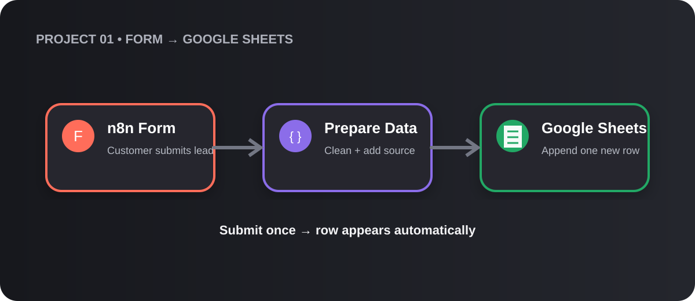
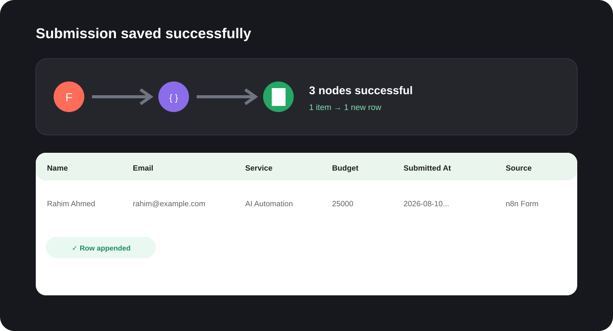

# Project 01 — Form to Google Sheets

An n8n workflow that collects project inquiries through a hosted form and saves each one as a new row in Google Sheets. It replaces copying form responses into a spreadsheet by hand: a lead submits once, and their details are in the sheet seconds later.



## Quick start

You need an n8n instance (cloud or self-hosted) and a Google account.

1. **Create the sheet.** Make a Google Sheet with a tab named `Leads` and paste these headers into row 1:

   ```
   Name	Email	Phone	Service	Budget	Message	Submitted At	Source
   ```

2. **Import the workflow.** In n8n, open **Workflows → Import from File** and choose `project01_form_to_sheets_template.json`.
3. **Connect Google Sheets.** Open the **Append row in sheet** node, add a Google Sheets OAuth2 credential, and replace `YOUR_GOOGLE_SHEET_ID` with your sheet's ID.
4. **Test it.** Open **On form submission**, copy the **Test URL**, submit a sample inquiry, and check that a row appears in `Leads`.
5. **Go live.** Activate the workflow and share the form's **Production URL**.



## Configuration

| Setting | Where | Replace with |
|---------|-------|--------------|
| `YOUR_GOOGLE_SHEET_ID` | Append row in sheet → Document | The ID in your sheet URL: `docs.google.com/spreadsheets/d/<ID>/edit` |
| Google Sheets credential | Append row in sheet → Credential | Your Google Sheets OAuth2 credential |
| `Leads` | Append row in sheet → Sheet | Another tab name, if you used one |

## How it works

| # | Node | Type | What it does |
|---|------|------|--------------|
| 1 | On form submission | Form Trigger | Hosts the **Project Inquiry** form and starts the workflow when someone clicks **Submit Inquiry** |
| 2 | Prepare Lead Data | Edit Fields (Set) | Maps each answer to a clean field, adds the submission time, and sets `Source` to `n8n Form` |
| 3 | Append row in sheet | Google Sheets | Appends the lead as one new row in `Leads` |

### Form fields

| Field | Input | Required |
|-------|-------|----------|
| Name | Text | Yes |
| Email | Email | Yes |
| Phone | Text (`01XXXXXXXXX`) | Yes |
| Service | Dropdown: AI Automation, Website, Digital Marketing, Other | Yes |
| Budget | Number | No |
| Message | Long text | No |

### Example row

| Name | Email | Service | Budget | Submitted At | Source |
|------|-------|---------|--------|--------------|--------|
| Rahim Ahmed | rahim@example.com | AI Automation | 25000 | 2026-08-10… | n8n Form |

## Troubleshooting

| Problem | Likely cause | Fix |
|---------|--------------|-----|
| Data lands in the wrong columns, or columns are blank | Sheet headers don't match the field names | Copy the headers from step 1 exactly, including `Submitted At` |
| "Sheet not found" error | Tab name is not `Leads` | Rename the tab or update the node's **Sheet** setting |
| Permission or credential error | Credential missing or expired | Reconnect the Google Sheets credential |
| Form works in testing but not for visitors | Workflow is inactive, or the Test URL was shared | Activate the workflow and share the **Production URL** |

## Files

| File | Description |
|------|-------------|
| `project01_form_to_sheets_template.json` | Workflow to import into n8n |
| `project01_workflow_map.svg` | Diagram of the flow |
| `project01_success.svg` | A successful run and the row it created |

## Ideas to extend

- Email the lead a confirmation with the Gmail node.
- Alert the team on Telegram or Slack for each new inquiry.
- Flag high-budget leads with an IF node.
- Skip duplicate emails before appending.
