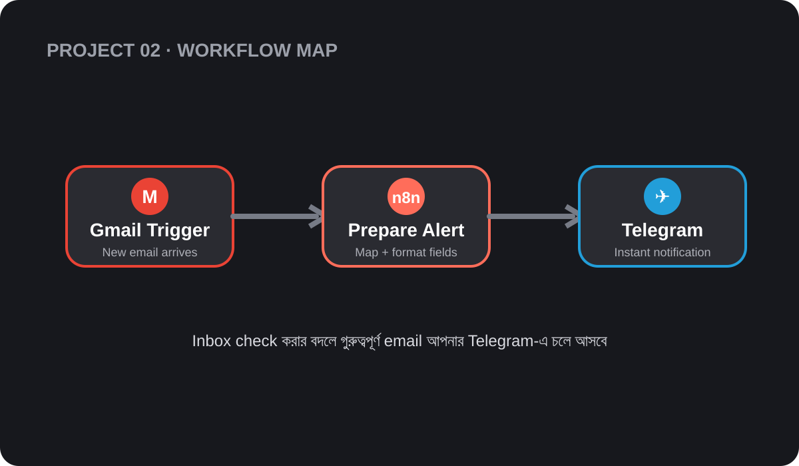
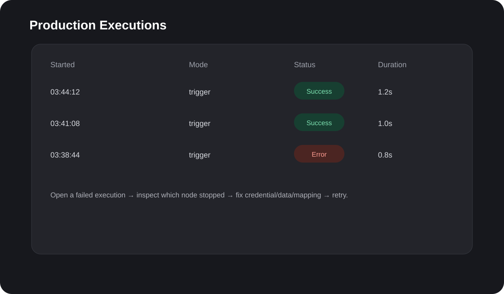

# Project 02 — Gmail to Telegram Alert

An n8n workflow that sends you a Telegram message whenever a new unread email arrives in Gmail. Instead of checking your inbox, you see the sender, subject and a preview on your phone within about a minute.



## Quick start

You need an n8n instance (cloud or self-hosted), a Gmail account and Telegram.

1. **Create a Telegram bot.** Message **@BotFather**, send `/newbot`, and copy the bot token. Then send your new bot any message so it's allowed to message you.
2. **Get your chat ID.** Message **@userinfobot**, or open `https://api.telegram.org/bot<TOKEN>/getUpdates` and copy `chat.id`.
3. **Import the workflow.** In n8n, open **Workflows → Import from File** and choose `project02_gmail_to_telegram_template.json`.
4. **Fill in the settings** listed under [Configuration](#configuration).
5. **Test it.** Click **Test workflow**, send yourself an email, and check that the alert reaches Telegram.
6. **Go live.** Activate the workflow.

The alert looks like this:

```
📩 New Email

From: Rahim Ahmed <rahim@example.com>
Subject: Project update

Hi, just checking in on the timeline for...
```

## Configuration

| Setting | Where | Replace with |
|---------|-------|--------------|
| Gmail credential | Gmail Trigger → Credential | Your Gmail OAuth2 credential |
| Telegram credential | Send Telegram Alert → Credential | A Telegram API credential using your bot token |
| `YOUR_CHAT_ID` | Send Telegram Alert → Chat ID | Your chat ID from step 2 |
| Poll interval | Gmail Trigger → Poll Times | Every minute by default; increase it to reduce executions |

## How it works

| # | Node | Type | What it does |
|---|------|------|--------------|
| 1 | Gmail Trigger | Gmail Trigger | Checks Gmail every minute for new unread emails |
| 2 | Prepare Telegram Alert | Edit Fields (Set) | Builds `alert_text` from the sender, subject and preview snippet |
| 3 | Send Telegram Alert | Telegram | Sends `alert_text` to your chat |

If an email has no sender or subject, the alert shows `Unknown sender` or `No subject` instead of failing.

## Troubleshooting

Each run is listed in the **Executions** tab with its status and duration:



When a run fails, open it, find the node that stopped, fix the cause, and retry.

| Problem | Likely cause | Fix |
|---------|--------------|-----|
| Fails at **Gmail Trigger** | Gmail credential expired or revoked | Reconnect the Gmail credential |
| Fails at **Send Telegram Alert** with "chat not found" | Wrong chat ID, or you haven't messaged the bot yet | Check the chat ID and send the bot a message first |
| Fails with "Unauthorized" | Wrong bot token | Recreate the Telegram credential with the correct token |
| Alert shows `\n` instead of line breaks | Line breaks typed as `\n` in the alert text | In **Prepare Telegram Alert**, replace each `\n` with a real line break |
| No alerts at all | Workflow inactive, or no new unread email | Activate the workflow and send a fresh test email |

## Files

| File | Description |
|------|-------------|
| `project02_gmail_to_telegram_template.json` | Workflow to import into n8n |
| `project02_workflow_map.svg` | Diagram of the flow |
| `project02_executions.svg` | Example of the Executions view |

## Ideas to extend

- Alert only for certain senders or labels with a Filter node.
- Summarize long emails with an AI node before sending.
- Mark each email as read after the alert goes out.
- Send alerts to a team group chat.
